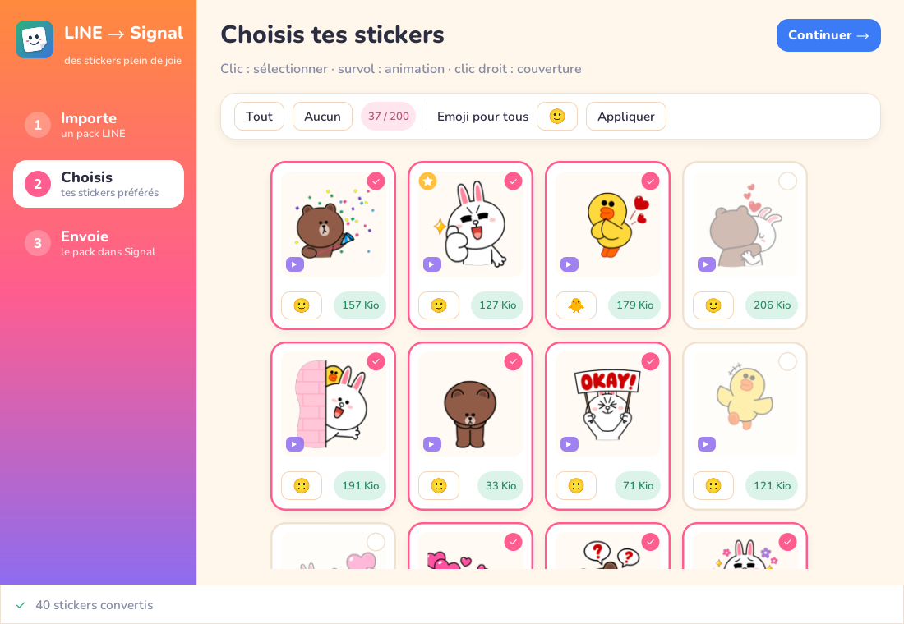
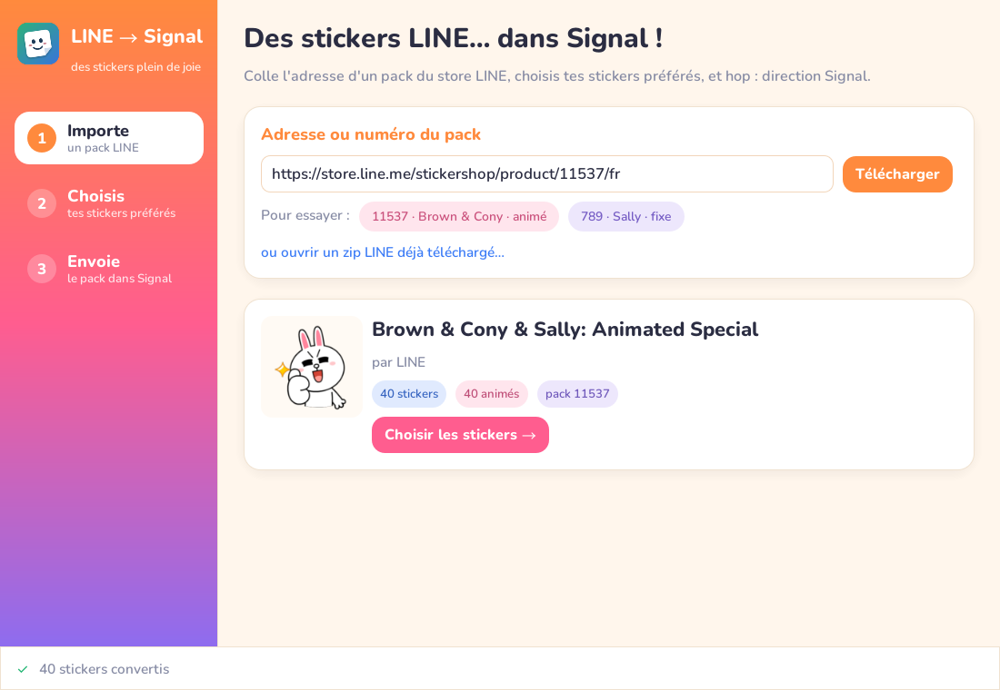
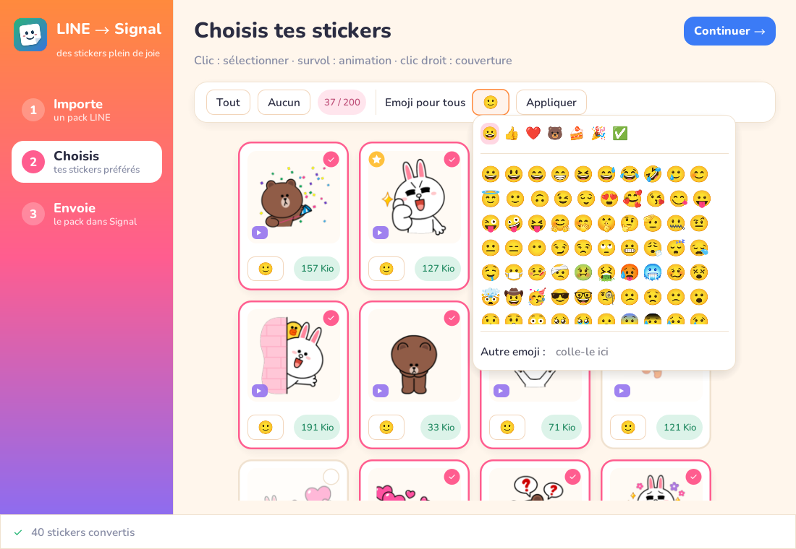
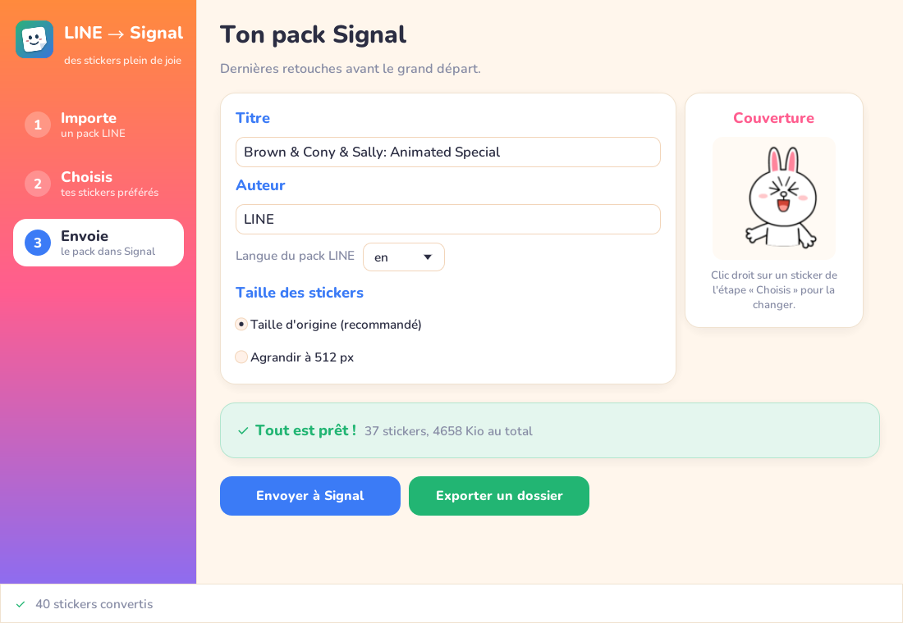
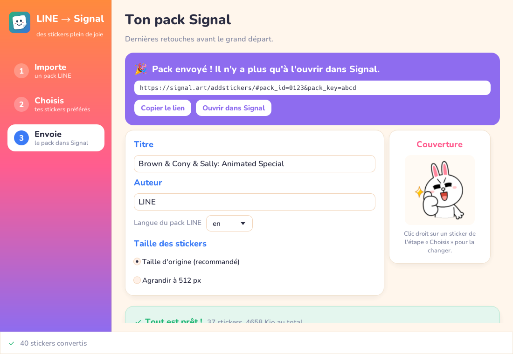
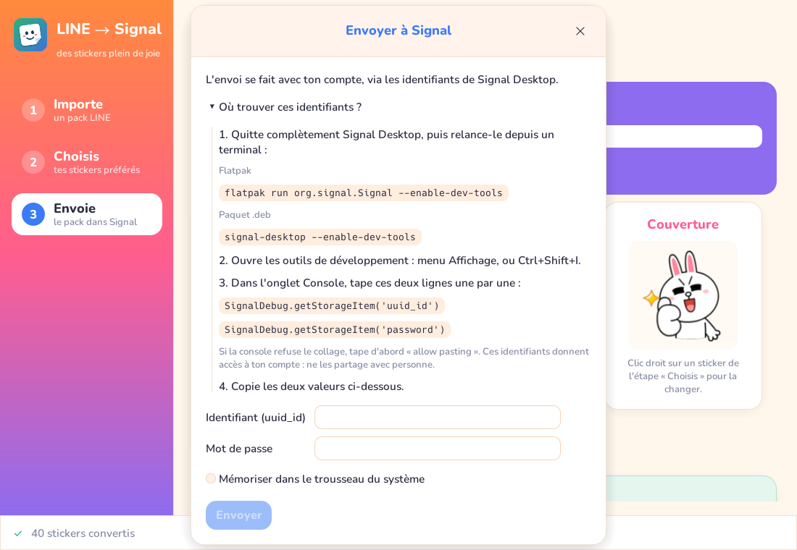

# LINE → Signal

[](https://github.com/Konosprod/line2sginal/actions/workflows/release.yml)

Convertit un pack de stickers LINE (fixe ou animé) en pack de stickers Signal.



## Utilisation

L'application se déroule en trois étapes, rappelées dans la barre de gauche.

### 1. Importe

Colle l'adresse du pack sur le store LINE (`https://store.line.me/stickershop/product/11537/fr`) ou
simplement son numéro, puis **Télécharger**. Les pastilles « Pour essayer » chargent des packs d'exemple,
et le lien du bas ouvre un zip LINE déjà téléchargé.



### 2. Choisis

- **Clic** sur un sticker pour le sélectionner ou le retirer (pastille rose ✔) ; *Tout* / *Aucun* en un clic.
- **Survol** pour voir l'animation (badge ▶ violet).
- **Clic droit** pour en faire la couverture du pack (étoile jaune).
- Chaque sticker a son **emoji**, obligatoire pour Signal. *Emoji pour tous* + *Appliquer* le donne à toute
  la sélection.
- La pastille de taille est **verte** si le sticker est intact, **orange** s'il a fallu le réduire
  (détail au survol), **rouge** s'il dépasse la limite de Signal.

Le bouton emoji ouvre une palette par catégories. Le champ *Autre emoji* accepte n'importe quel emoji
(tons de peau, drapeaux…) et en affiche l'aperçu.



### 3. Envoie

Vérifie le titre et l'auteur (repris de LINE, avec choix de la langue) et la taille des stickers.
L'encadré vert confirme que le pack est prêt ; sinon, l'encadré orange liste ce qu'il reste à corriger.



Deux façons de l'ajouter à Signal :

- **Envoyer à Signal** : envoi direct avec ton compte (voir [Identifiants Signal](#identifiants-signal-envoi-direct)).
  Tu obtiens un lien `https://signal.art/addstickers/…` : **Ouvrir dans Signal**, puis *Installer*.
- **Exporter un dossier** : des fichiers `001.png`, `002.png`… et un `pack.json` avec les emojis, à importer
  dans Signal Desktop via *Fichier → Créer/téléverser un pack de stickers*.



Le pack n'est listé nulle part, mais toute personne qui a le lien peut l'installer, et Signal ne permet pas
de le supprimer ensuite.

## Conversion

Signal demande des images carrées de 512 px au plus, de 300 Kio au plus, et des APNG qui bouclent à l'infini.
Par défaut, les stickers gardent leur taille d'origine, centrés sur un carré transparent. Si un fichier
dépasse 300 Kio, l'application passe en palette 256 couleurs, puis réduit la taille, puis saute des images.
Le détail des réductions s'affiche au survol de la taille de chaque sticker.

## Identifiants Signal (envoi direct)

En production, Signal Desktop n'affiche ses outils de développement qu'avec `--enable-dev-tools`.
Quitte complètement Signal, puis relance-le :

| Système | Commande |
| --- | --- |
| Linux (Flatpak) | `flatpak run org.signal.Signal --enable-dev-tools` |
| Linux (.deb) | `signal-desktop --enable-dev-tools` |
| macOS | `open -a Signal --args --enable-dev-tools` |
| Windows | `"%LOCALAPPDATA%\Programs\signal-desktop\Signal.exe" --enable-dev-tools` |

Ouvre ensuite *Affichage → Outils de développement* (Ctrl+Shift+I, ou Cmd+Option+I), onglet *Console* :

```js
SignalDebug.getStorageItem('uuid_id')
SignalDebug.getStorageItem('password')
```

Les identifiants peuvent être mémorisés dans le trousseau du système.
Ces instructions sont aussi rappelées dans la fenêtre d'envoi :



## Installation

Les binaires de chaque release ne sont pas signés :

- **macOS** : `xattr -cr "LINE to Signal.app"` avant la première ouverture ;
- **Windows** : SmartScreen → *Informations complémentaires* → *Exécuter quand même* ;
- **Linux** : pour avoir l'icône sous Wayland, copier `line2signal.desktop` dans
  `~/.local/share/applications/` et `line2signal.png` dans `~/.local/share/icons/`,
  avec `line2signal` dans le `PATH`.

## Crédits

Polices [Nunito](https://github.com/googlefonts/nunito), [Noto Sans JP](https://github.com/notofonts/noto-cjk)
et [Noto Color Emoji](https://github.com/googlefonts/noto-emoji) (`assets/fonts`) : SIL Open Font License 1.1.

## Développement

```sh
cargo run
cargo test                    # tests hors ligne
cargo test -- --ignored
```